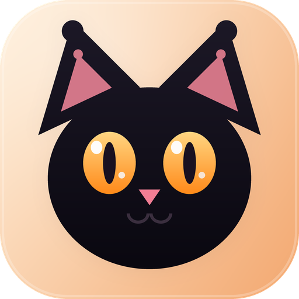
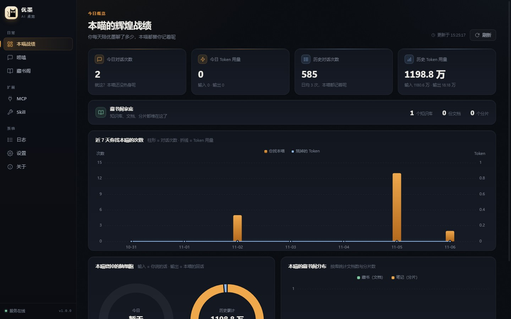
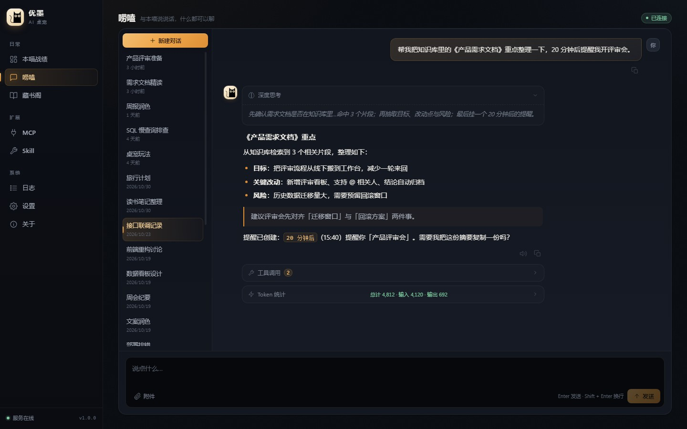
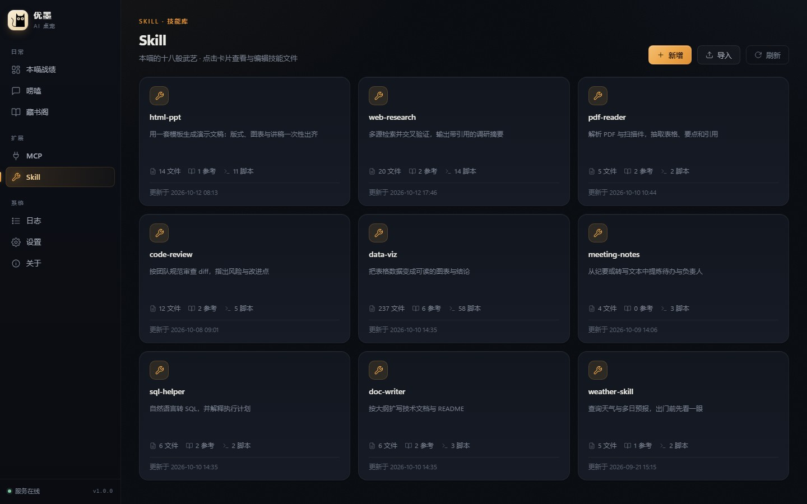
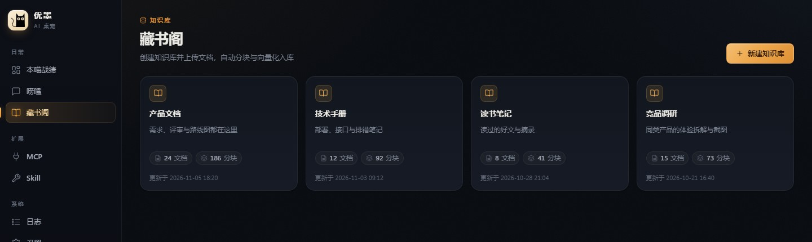
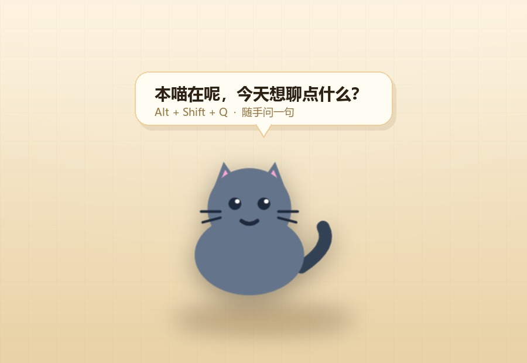

<div align="center">



# 优墨 · Sassy Cat

**A slightly sassy desktop cat that chats, remembers, reminds — and actually gets real work done.**

<sub>Electron + Vue 3 desktop shell · Python AI agent backend · animated desktop pet</sub>

<br />


<br /><br />

[English](README.md) · [简体中文](README.zh-CN.md)

[Screenshots](#-screenshots) · [Highlights](#-highlights) · [Tech Stack](#-tech-stack) · [Architecture](#-architecture) · [Quick Start](#-quick-start) · [User Guide](#-user-guide) · [Development](#-development) · [Configuration](#-configuration) · [FAQ](#-faq)

</div>

---

**优墨** is a black cat that lives on your desktop. It stitches together an **Electron + Vue 3 desktop shell**, a **Python AI agent backend**, and an **animated desktop pet**:

- Ask in plain language — it runs commands, reads and writes files, writes code, and searches your own knowledge base.
- Risky operations pause and ask you first; it never quietly deletes your work.
- Long jobs are handed to an isolated subagent, so the main conversation never blocks.
- When idle, it naps in the corner and occasionally peeks out to ask what you're up to.

> The UI is in Chinese. All conversations and data in the screenshots are illustrative demo content.

## 📸 Screenshots



<table>
  <tr>
    <td width="50%"></td>
    <td width="50%"></td>
  </tr>
  <tr>
    <td align="center"><sub><b>Chat</b> · streaming replies, reasoning, tool calls, token usage</sub></td>
    <td align="center"><sub><b>Skills</b> · plugin library, in-app file tree, import / export</sub></td>
  </tr>
</table>



## ✨ Highlights

| | |
| :-- | :-- |
| **🐾 It actually lives on your desktop**<br>A transparent, always-on-top, draggable pet with idle / walk / talk / think / sleep / remind animations and moods. Its speech bubble grows with the answer. | **🧠 It thinks — and acts**<br>A LangGraph-powered agent with streaming output, tool calls and multi-turn memory. Shell, Python and file I/O included, with human-in-the-loop confirmation for anything dangerous. |
| **📚 Local-first RAG**<br>Multiple knowledge bases with automatic chunking and vector indexing (ChromaDB). The local `bge-small-zh` embedding model works out of the box; PDFs, Office files and images go through OCR. | **🛠 An extensible toolbox**<br>Plug in MCP servers directly. Drop a skill directory into `runtime/skills/` and it becomes a new capability — browse, create and edit them in-app. |
| **⏰ It reaches out first**<br>Ignore it too long and it pops up to ask why. Say "remind me in 20 minutes" and it will. Replies can also be read aloud. | **🎨 A UI that was actually designed**<br>Streaming Markdown, syntax highlighting, LaTeX and Mermaid; usage analytics, knowledge-base stats and live backend logs. |

### 🐾 Desktop Pet

<p align="center">
  
</p>

The pet is its own always-on-top window sharing the same agent session as the main window:

- Press `Alt + Shift + Q` to ask the cat directly; answers sync back to the main window.
- Click, drag, pet — it reacts. Optional click-through keeps it out of your way.
- Bubbles show live agent replies and reminders; long answers expand in place.

## 🚀 Quick Start

**Requirements:** Node.js 18+, npm 9+. Python 3.10+ is optional — an embedded Python is downloaded automatically on first launch if none is found.

```bash
git clone https://github.com/zjwan461/sassy-cat.git
cd sassy-cat
npm install
```

**Windows (one-click):**

```bash
start.bat
```

**macOS / Linux:**

```bash
npm run electron:dev
```

The first launch runs an environment check and installs `requirements.txt`, then starts the Python backend (FastAPI + asyncio). Once the pet appears, open **Settings** and configure an LLM (Base URL / API Key / model name — OpenAI-compatible endpoints and DeepSeek both work), then save.

> Packaging: `npm run electron:build` for the current platform, or `electron:build:win` / `:mac` / `:linux`. Artifacts land in `dist_electron/`.

## 🛠 Tech Stack

| Layer | Technology |
| :-- | :-- |
| Desktop shell | Electron 28 + electron-builder |
| Frontend | Vue 3 (Composition API) + Vue Router + Vite 5 + ECharts |
| Chat rendering | markdown-it + highlight.js + KaTeX + Mermaid |
| Backend | Python 3.11 + FastAPI + uvicorn + asyncio (single-process) |
| AI Agent | LangChain + LangGraph + DeepAgents + langchain-mcp-adapters |
| Hands-on subagent | deepseek-harness-sdk (isolated worker process) |
| Knowledge base | ChromaDB + sentence-transformers + langchain-huggingface |
| Document parsing | MarkItDown + Docling + RapidOCR + Unstructured |
| Persistence | SQLAlchemy (async) + SQLite (aiosqlite) + Alembic |
| Communication | WebSocket (chat/events) + IPC (window/config) + stdio protocol lines (logs/ready) |

## 🏗 Architecture

```
┌──────────────────────────────────────────────────────────────────────────────┐
│  Main window (src/index.html)          Pet window (transparent, pet/pet.html) │
│      │ IPC (preload.js)                    │ IPC (pet-preload.js)             │
│  config-store.js two-layer config ──► config.user.json                        │
│  python-env-checker.js ──► spawn & supervise python/main.py                  │
└──────────────────────────────────────────┬───────────────────────────────────┘
                                           │
                 ┌─────────────────────────┴─────────────────────────┐
                 │       Python backend (FastAPI, single-process)     │
                 │  /ws/agent  WebSocket: streaming chat / tools /    │
                 │             proactive reminders                    │
                 │  REST: /api/kb /api/conversations /api/stats       │
                 │        /api/skills /api/mcp                        │
                 │  ┌───────────┐ ┌─────────┐ ┌────────┐ ┌────────┐   │
                 │  │   Agent   │ │  RAG    │ │ Monitor│ │Proactive│  │
                 │  │ LangGraph │ │ ChromaDB│ │ psutil │ │ idle & │   │
                 │  │ + tools   │ │ + OCR   │ │ pynvml │ │greeting│   │
                 │  │ + DSH sub.│ └─────────┘ └────────┘ └────────┘   │
                 │  └────┬──────┘                                     │
                 │       │ SQLite (messages.sqlite) + Alembic          │
                 └───────┴──── WebSocket ◄── renderer direct ──────────┘
```

Design notes worth knowing:

- **The renderer talks to the Python WebSocket directly** — chat tokens, tool state and proactive events skip the main process for lower latency; window control and config persistence still go through IPC.
- **Single-process asyncio backend** — FastAPI, metric collection, proactive scheduling and the agent engine share one process supervised by Electron; blocking calls are wrapped in `to_thread`.
- **stdio protocol lines** — Python emits `__PROTOCOL__` log lines and a `[READY] {"port":…}` signal; the port falls back automatically if the preferred one is taken.
- **Two-layer config** — `config.json` (template, updated with the app) deep-merged with `userData/config.user.json` (user overrides), so upgrades never lose settings.
- **Subagent isolation** — the hands-on DSH subagent runs in its own worker process with only the delegated task; multi-step work must start with a todo list.

## 📁 Project Structure

<details>
<summary>Expand the directory tree</summary>

```text
sassy-cat/
├── electron/                      # Main process
│   ├── main.js                    # Entry (main + pet window + tray + Python lifecycle)
│   ├── preload.js / pet-preload.js
│   ├── config-store.js            # Two-layer config (deep merge + atomic write)
│   └── python-env-checker.js      # Python env check / embedded Python download
├── src/                           # Main-window Vue 3 frontend
│   ├── styles/                    # Design tokens + base layer ("ink night · amber")
│   ├── views/                     # Dashboard / Chat / KB / Skills / MCP / Settings / Logs …
│   ├── components/                # AppIcon / MarkdownRenderer / conversation item / previews
│   ├── composables/               # WS client / chat store / upload / TTS / state
│   ├── utils/streamSplitter.js    # Streaming chunk splitter
│   └── api/                       # REST clients
├── pet/                           # Pet window (separate Vite entry)
│   ├── pet.html / pet-main.js
│   ├── assets/sprites/cat/        # Sprite frames + action config
│   └── components/                # Bubbles / interaction / sprite renderers
├── python/                        # Backend (single-process asyncio)
│   ├── main.py                    # [READY] signal + port fallback
│   ├── server/                    # FastAPI routes, WS, event bus, DB/Alembic
│   ├── agent/                     # Engine, streaming bridge, prompts, tools, RAG
│   ├── monitor/                   # System metric collection
│   ├── ocr/                       # Document parsing engines
│   └── proactive/                 # Idle detection / greetings / reminders
├── runtime/skills/                # Skill plugin directory
├── docs/screenshots/              # README images
├── plans/                         # Design & migration docs
├── tests/                         # Verification / probe scripts
├── config.json                    # App config template
├── requirements.txt
└── vite.config.js                 # Multi-page entries (index / setup / pet)
```
</details>

## 📖 User Guide

### First launch

1. An environment check runs automatically (Python / dependency install); the setup window shows progress.
2. Open **Settings**, configure at least one LLM — Base URL, API Key, model name — then save and activate it.
3. Open **Chat** or poke the pet to start talking. `Alt + Shift + Q` asks the cat directly.

### Knowledge base

1. **Library** → create a knowledge base.
2. Upload PDFs, Word, Excel, images and more — documents are parsed (OCR / document engines), chunked and vectorized automatically.
3. During chat, ask the agent to answer "based on my knowledge base", or just ask related questions.
4. The default local embedding model is `BAAI/bge-small-zh-v1.5`, downloaded on first use; a remote embedding API can be configured instead.

### Skills & MCP

- **Skills**: drop a directory containing `SKILL.md` into `runtime/skills/`; browse, edit and enable it from the Skills page. A bundled `html-ppt` skill is included as an example.
- **MCP**: add server configs (command / args / env) on the MCP page and the agent can call the tools they expose.

### Dangerous action confirmation

By default the agent **interrupts and waits for your confirmation** before running shell commands, writing, editing or deleting files. Tune this per tool via `agent.interruptOn` in `config.json`.

### Proactive reminders

The pet greets you after a period of idleness; you can also say "remind me to drink water in 10 minutes" and it will bubble up on schedule. Replies can be read aloud (Web Speech).

## 🔧 Development

<details>
<summary>Frontend / pet / backend / migrations / tests</summary>

### Frontend (main window)

Vue 3 + Vite, alias `@` → `src/`:

- [`ChatView.vue`](src/views/ChatView.vue) — chat page (streaming + tool state + history)
- [`Dashboard.vue`](src/views/Dashboard.vue) — usage dashboard (ECharts)
- [`KnowledgeBase.vue`](src/views/KnowledgeBase.vue) / [`KnowledgeBaseDetail.vue`](src/views/KnowledgeBaseDetail.vue) — knowledge-base management
- [`useAgentSocket.js`](src/composables/useAgentSocket.js) — WebSocket client (singleton + auto-reconnect)
- [`MarkdownRenderer.vue`](src/components/MarkdownRenderer.vue) — rich rendering + incremental chunks

The design system is documented in [`plans/ui-design-system.md`](plans/ui-design-system.md); colors, radii and shadows all come from [`src/styles/tokens.css`](src/styles/tokens.css), with primitives in [`src/styles/base.css`](src/styles/base.css).

### Pet window

- [`PetApp.vue`](pet/components/PetApp.vue) — bubbles, dragging, click interaction, state orchestration
- [`pet/components/sprite/`](pet/components/sprite/) — sprite rendering (SVG / spritesheet backends, preloading)
- [`pet/assets/sprites/cat/config.json`](pet/assets/sprites/cat/config.json) — actions and frame-rate config

### Python backend

- [`main.py`](python/main.py) — service entry (port fallback + `[READY]`)
- [`server/ws_agent.py`](python/server/ws_agent.py) — WebSocket chat and session management
- [`agent/engine.py`](python/agent/engine.py) / [`agent/runner.py`](python/agent/runner.py) — agent builder and streaming bridge
- [`agent/tools/`](python/agent/tools/) — built-in shell/file tools, RAG, reminders, MCP, DSH subagent
- [`proactive/scheduler.py`](python/proactive/scheduler.py) — idle detection / greetings / reminder scheduling

Add Python dependencies to [`requirements.txt`](requirements.txt); they are installed automatically at startup.

### Database migrations

Schema is managed by Alembic (`python/server/db/migrations/`) and auto-upgraded at startup. When changing tables, follow [MIGRATION.md](MIGRATION.md): autogenerate → manual review → verification.

### Tests

`tests/` contains verification and probe scripts, e.g. [`stream_splitter.test.mjs`](tests/stream_splitter.test.mjs) and [`incremental_render_equivalence.test.mjs`](tests/incremental_render_equivalence.test.mjs).

</details>

## ⚙️ Configuration

<details>
<summary>Config template and field reference</summary>

The root [`config.json`](config.json) is the template layer (updated with the app); user overrides live in `userData/config.user.json`:

```json
{
  "app": { "name": "优墨", "version": "1.0.0" },
  "agent": {
    "memoryWindow": 50,
    "recursionLimit": 100,
    "enableOcr": true,
    "ocrEngine": "markitdown",
    "interruptOn": { "execute": true, "write_file": true, "edit_file": true, "delete": true }
  },
  "dsh": { "useMainLlm": true, "maxTokens": 131072, "reasoningEffort": "" },
  "rag": {
    "autoEmbedding": true,
    "embeddingModel": { "type": "local", "model": "BAAI/bge-small-zh-v1.5" },
    "ocrEngine": "docling"
  },
  "pet": {
    "enabled": true,
    "quickAsk": { "shortcut": "Alt+Shift+Q" },
    "reminders": { "pollIntervalSeconds": 5, "bubbleDurationMs": 8000 }
  },
  "voice": { "enabled": false, "engine": "web-speech", "autoRead": false, "rate": 1.0, "pitch": 1.0 },
  "network": { "proxy": { "enabled": false, "http": "", "https": "", "noProxy": "" } },
  "pythonVersion": "3.11.9"
}
```

| Section | Description |
| :-- | :-- |
| `agent` | Memory window, recursion limit, OCR toggle & engine, dangerous-action confirmation |
| `dsh` | Subagent model source, maxTokens, reasoning effort |
| `rag` | Embedding model (local/remote), auto-embedding, document parse engine |
| `pet` | Pet toggle, quick-ask shortcut, reminder polling and bubble duration |
| `voice` | Read-aloud toggle, engine, auto-read, voice name / rate / pitch |
| `network` | HTTP/HTTPS proxy |

Changing `pythonVersion` switches the embedded Python; if one was already downloaded, delete `python_env/` and restart.
</details>

## ❓ FAQ

<details>
<summary><b>The Python service didn't start / chat is unresponsive</b></summary>

Check the **Logs** page for backend output. The first launch downloads an embedded Python and installs dependencies, which takes a while — that's expected. If the port is occupied the backend falls back to a free one. Dependency install failures are usually network issues; configure a proxy in Settings and restart.
</details>

<details>
<summary><b>The embedding model failed to download</b></summary>

The default downloads `BAAI/bge-small-zh-v1.5` from HuggingFace. On restricted networks, configure a proxy or switch to a remote embedding API.
</details>

<details>
<summary><b>The pet is missing</b></summary>

There's a pet toggle in Settings (`pet.enabled` in `config.json`). The window is transparent and always-on-top; you can also toggle its visibility from the tray menu.
</details>

<details>
<summary><b>Every command needs confirmation — too noisy?</b></summary>

Confirmation is controlled by `agent.interruptOn` and can be disabled per tool (turning everything off is not recommended).
</details>

## 🗺 Roadmap

Ongoing design and migration docs live in [`plans/`](plans/):

- ✅ Pet sprite animation migration
- ✅ TTS voice read-aloud
- ✅ Streaming Markdown rendering performance
- ✅ DSH subagent settings
- ✅ UI design system ("ink night · amber")
- 🚧 Agent error retry
- 🚧 Context window compression

## 📝 License

[Apache License 2.0](LICENSE)

## 🤝 Contributing

Issues and pull requests are welcome. Before making changes, please read the relevant design docs under [`plans/`](plans/) to keep the architecture consistent.

## 📮 Feedback

- Homepage: <https://github.com/zjwan461/sassy-cat>
- Issues: <https://github.com/zjwan461/sassy-cat/issues>
- Releases: <https://github.com/zjwan461/sassy-cat/releases>
