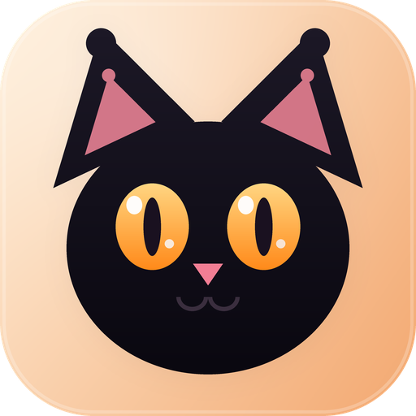
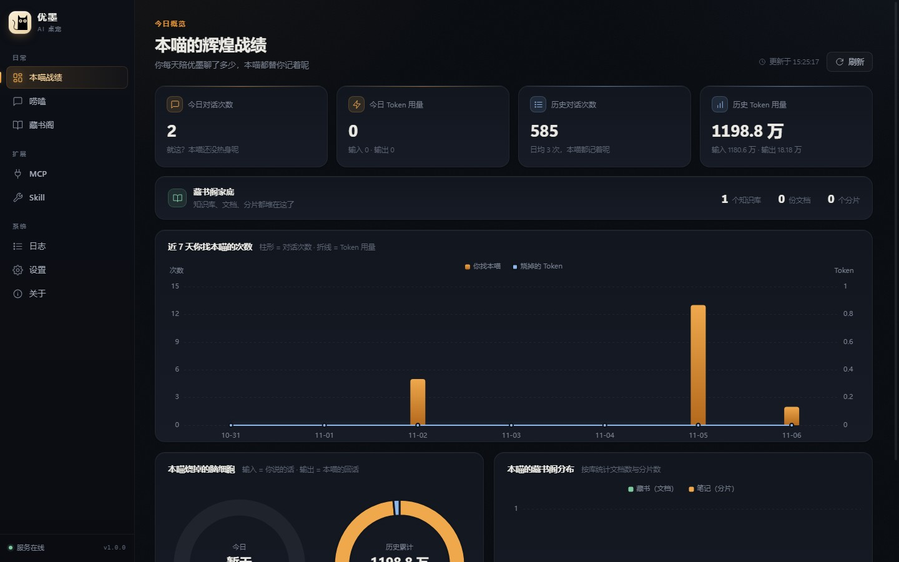
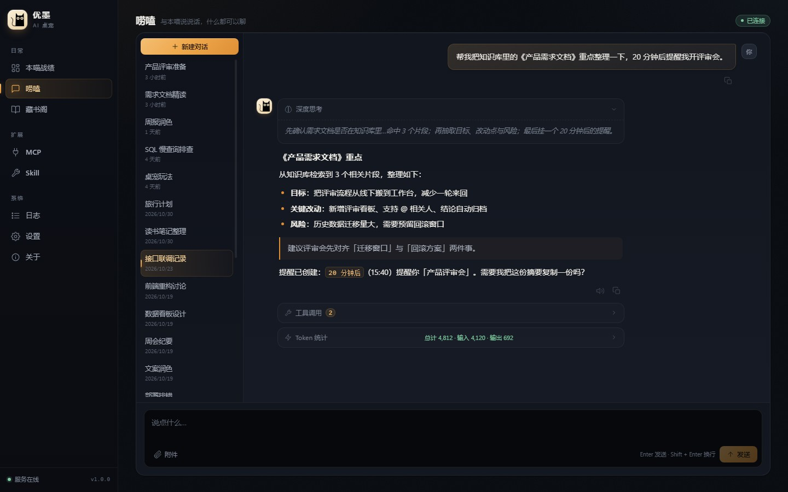
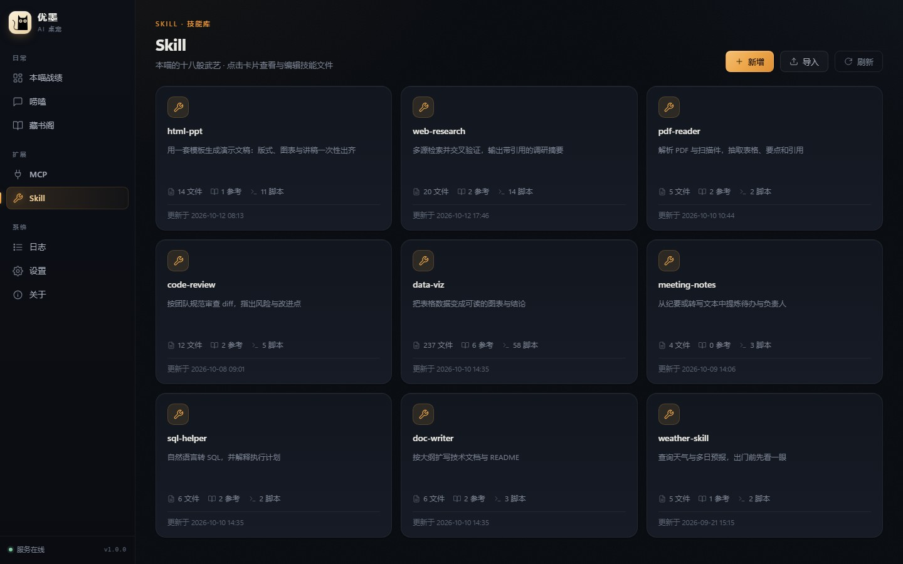
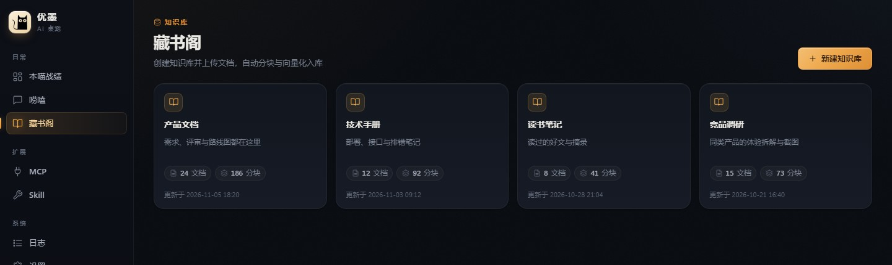
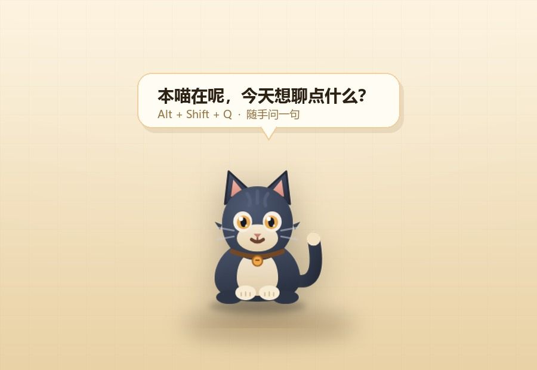

<div align="center">



# 优墨 · Sassy Cat

**一只有点拽但靠谱的桌宠：会聊天、记事、提醒你，还真能把活儿干完。**

<sub>Electron + Vue 3 桌面外壳 · Python AI Agent 后端 · 会动的桌面宠物</sub>

<br />


<br /><br />

[English](README.md) · [简体中文](README.zh-CN.md)

[截图](#-截图) · [亮点](#-亮点) · [技术栈](#-技术栈) · [架构](#-架构) · [快速开始](#-快速开始) · [使用指南](#-使用指南) · [开发](#-开发) · [配置](#-配置) · [常见问题](#-常见问题)

</div>

---

**优墨** 是一只住在你桌面上的黑猫。它把 **Electron + Vue 3 桌面外壳**、**Python AI Agent 后端** 和一只**会动的桌面宠物**缝在了一起：

- 用大白话吩咐就行 —— 它会执行命令、读写文件、写代码，还能翻你自己的知识库。
- 有风险的操作会先停下来问你，绝不会背着你把东西删了。
- 长任务交给独立的子代理去做，主对话永远不卡。
- 闲着的时候它窝在角落打盹，偶尔探个头问问你在忙什么。

> 界面为中文。截图里的所有对话与数据均为演示内容。

## 📸 截图



<table>
  <tr>
    <td width="50%"></td>
    <td width="50%"></td>
  </tr>
  <tr>
    <td align="center"><sub><b>聊天</b> · 流式回复、推理过程、工具调用、Token 用量</sub></td>
    <td align="center"><sub><b>技能</b> · 插件库、应用内文件树、导入 / 导出</sub></td>
  </tr>
</table>



## ✨ 亮点

| | |
| :-- | :-- |
| **🐾 它真的住在你桌面上**<br>一只透明、置顶、可拖拽的桌宠，idle / walk / talk / think / sleep / remind 全套动作和心情都有。回答越长，气泡越大。 | **🧠 它会想，也会动手**<br>LangGraph 驱动的 Agent，支持流式输出、工具调用和多轮记忆。shell、Python、文件读写一应俱全，任何危险操作都要过 human-in-the-loop 确认。 |
| **📚 本地优先的 RAG**<br>支持多个知识库，自动分块并建立向量索引（ChromaDB）。本地 `bge-small-zh` 嵌入模型开箱即用；PDF、Office 文件和图片走 OCR。 | **🛠 一个能长大的工具箱**<br>直接挂 MCP 服务器。把技能目录丢进 `runtime/skills/`，它就变成一项新能力 —— 在应用里就能浏览、创建、编辑。 |
| **⏰ 它会先开口**<br>冷落它太久，它会跳出来问你怎么回事。说一句“20 分钟后提醒我”，它就真会提醒。回复还能念出来。 | **🎨 认真设计过的界面**<br>流式 Markdown、代码高亮、LaTeX 和 Mermaid；还有用量分析、知识库统计和后端实时日志。 |

### 🐾 桌面宠物

<p align="center">
  
</p>

桌宠是一个独立的置顶窗口，和主窗口共用同一个 Agent 会话：

- 按 `Alt + Shift + Q` 直接问猫，回答会同步回主窗口。
- 点它、拖它、摸它，它都有反应。可选鼠标穿透，让它不挡你的事。
- 气泡会实时显示 Agent 的回复和提醒，长回答在原地展开。

## 🚀 快速开始

**环境要求：** Node.js 18+、npm 9+。Python 3.10+ 是可选的 —— 系统里找不到的话，首次启动会自动下载一个嵌入式 Python。

```bash
git clone https://github.com/zjwan461/sassy-cat.git
cd sassy-cat
npm install
```

**Windows（一键启动）：**

```bash
start.bat
```

**macOS / Linux：**

```bash
npm run electron:dev
```

首次启动会跑一遍环境检查、安装 `requirements.txt`，然后拉起 Python 后端（FastAPI + asyncio）。等猫咪出现在桌面上，打开 **设置** 配一个 LLM（Base URL / API Key / 模型名 —— OpenAI 兼容接口和 DeepSeek 都能用），保存即可。

> 打包：当前平台用 `npm run electron:build`，也可以 `electron:build:win` / `:mac` / `:linux`。产物落在 `dist_electron/`。

## 🛠 技术栈

| 层 | 技术 |
| :-- | :-- |
| 桌面外壳 | Electron 28 + electron-builder |
| 前端 | Vue 3 (Composition API) + Vue Router + Vite 5 + ECharts |
| 聊天渲染 | markdown-it + highlight.js + KaTeX + Mermaid |
| 后端 | Python 3.11 + FastAPI + uvicorn + asyncio（单进程） |
| AI Agent | LangChain + LangGraph + DeepAgents + langchain-mcp-adapters |
| 动手子代理 | deepseek-harness-sdk（独立 worker 进程） |
| 知识库 | ChromaDB + sentence-transformers + langchain-huggingface |
| 文档解析 | MarkItDown + Docling + RapidOCR + Unstructured |
| 持久化 | SQLAlchemy (async) + SQLite (aiosqlite) + Alembic |
| 通信 | WebSocket（聊天/事件）+ IPC（窗口/配置）+ stdio 协议行（日志/就绪） |

## 🏗 架构

```
┌──────────────────────────────────────────────────────────────────────────────┐
│  Main window (src/index.html)          Pet window (transparent, pet/pet.html) │
│      │ IPC (preload.js)                    │ IPC (pet-preload.js)             │
│  config-store.js two-layer config ──► config.user.json                        │
│  python-env-checker.js ──► spawn & supervise python/main.py                  │
└──────────────────────────────────────────┬───────────────────────────────────┘
                                           │
                 ┌─────────────────────────┴─────────────────────────┐
                 │       Python backend (FastAPI, single-process)     │
                 │  /ws/agent  WebSocket: streaming chat / tools /    │
                 │             proactive reminders                    │
                 │  REST: /api/kb /api/conversations /api/stats       │
                 │        /api/skills /api/mcp                        │
                 │  ┌───────────┐ ┌─────────┐ ┌────────┐ ┌────────┐   │
                 │  │   Agent   │ │  RAG    │ │ Monitor│ │Proactive│  │
                 │  │ LangGraph │ │ ChromaDB│ │ psutil │ │ idle & │   │
                 │  │ + tools   │ │ + OCR   │ │ pynvml │ │greeting│   │
                 │  │ + DSH sub.│ └─────────┘ └────────┘ └────────┘   │
                 │  └────┬──────┘                                     │
                 │       │ SQLite (messages.sqlite) + Alembic          │
                 └───────┴──── WebSocket ◄── renderer direct ──────────┘
```

几个值得知道的设计点：

- **渲染进程直接连 Python 的 WebSocket** —— 聊天 token、工具状态和主动事件都绕过主进程，延迟更低；窗口控制和配置持久化仍然走 IPC。
- **单进程 asyncio 后端** —— FastAPI、指标采集、主动调度和 Agent 引擎共用一个进程，由 Electron 监管；阻塞调用统一用 `to_thread` 包起来。
- **stdio 协议行** —— Python 会输出 `__PROTOCOL__` 日志行和 `[READY] {"port":…}` 就绪信号；首选端口被占用时会自动回退。
- **双层配置** —— `config.json`（模板，随应用更新）与 `userData/config.user.json`（用户覆盖）深度合并，升级永远不丢设置。
- **子代理隔离** —— 动手的 DSH 子代理跑在自己的 worker 进程里，只拿到被委托的那件事；多步骤任务必须先建好 todo 清单。

## 📁 项目结构

<details>
<summary>展开目录树</summary>

```text
sassy-cat/
├── electron/                      # Main process
│   ├── main.js                    # Entry (main + pet window + tray + Python lifecycle)
│   ├── preload.js / pet-preload.js
│   ├── config-store.js            # Two-layer config (deep merge + atomic write)
│   └── python-env-checker.js      # Python env check / embedded Python download
├── src/                           # Main-window Vue 3 frontend
│   ├── styles/                    # Design tokens + base layer ("ink night · amber")
│   ├── views/                     # Dashboard / Chat / KB / Skills / MCP / Settings / Logs …
│   ├── components/                # AppIcon / MarkdownRenderer / conversation item / previews
│   ├── composables/               # WS client / chat store / upload / TTS / state
│   ├── utils/streamSplitter.js    # Streaming chunk splitter
│   └── api/                       # REST clients
├── pet/                           # Pet window (separate Vite entry)
│   ├── pet.html / pet-main.js
│   ├── assets/sprites/cat/        # Sprite frames + action config
│   └── components/                # Bubbles / interaction / sprite renderers
├── python/                        # Backend (single-process asyncio)
│   ├── main.py                    # [READY] signal + port fallback
│   ├── server/                    # FastAPI routes, WS, event bus, DB/Alembic
│   ├── agent/                     # Engine, streaming bridge, prompts, tools, RAG
│   ├── monitor/                   # System metric collection
│   ├── ocr/                       # Document parsing engines
│   └── proactive/                 # Idle detection / greetings / reminders
├── runtime/skills/                # Skill plugin directory
├── docs/screenshots/              # README images
├── plans/                         # Design & migration docs
├── tests/                         # Verification / probe scripts
├── config.json                    # App config template
├── requirements.txt
└── vite.config.js                 # Multi-page entries (index / setup / pet)
```
</details>

## 📖 使用指南

### 首次启动

1. 会自动跑一遍环境检查（Python / 依赖安装），引导窗口（Setup）会显示进度。
2. 打开 **设置**，至少配好一个 LLM —— Base URL、API Key、模型名 —— 保存并启用它。
3. 打开 **聊天**，或者戳一戳桌宠开始说话。`Alt + Shift + Q` 可以直接问猫。

### 知识库

1. **知识库** → 新建一个知识库。
2. 上传 PDF、Word、Excel、图片等等 —— 文档会自动解析（OCR / 文档引擎）、分块、向量化。
3. 聊天时让 Agent“根据我的知识库”来回答，或者干脆直接问相关问题。
4. 默认的本地嵌入模型是 `BAAI/bge-small-zh-v1.5`，首次使用时下载；也可以改成远程 embedding API。

### 技能与 MCP

- **技能**：把一个含 `SKILL.md` 的目录丢进 `runtime/skills/`，就能在技能页浏览、编辑、启用它。内置了一个 `html-ppt` 技能作为示例。
- **MCP**：在 MCP 页添加服务器配置（command / args / env），Agent 就能调用它们暴露出来的工具。

### 危险操作确认

默认情况下，Agent 在执行 shell 命令、写文件、改文件、删文件之前会**中断并等你确认**。可以在 `config.json` 的 `agent.interruptOn` 里按工具单独调整。

### 主动提醒

你太久不理它，它会主动凑过来打个招呼；也可以说“10 分钟后提醒我喝水”，它会准时冒泡。回复还可以念出来（Web Speech）。

## 🔧 开发

<details>
<summary>前端 / 桌宠 / 后端 / 迁移 / 测试</summary>

### 前端（主窗口）

Vue 3 + Vite，别名 `@` → `src/`：

- [`ChatView.vue`](src/views/ChatView.vue) —— 聊天页（流式 + 工具状态 + 历史）
- [`Dashboard.vue`](src/views/Dashboard.vue) —— 用量仪表盘（ECharts）
- [`KnowledgeBase.vue`](src/views/KnowledgeBase.vue) / [`KnowledgeBaseDetail.vue`](src/views/KnowledgeBaseDetail.vue) —— 知识库管理
- [`useAgentSocket.js`](src/composables/useAgentSocket.js) —— WebSocket 客户端（单例 + 自动重连）
- [`MarkdownRenderer.vue`](src/components/MarkdownRenderer.vue) —— 富文本渲染 + 增量分块

设计系统记录在 [`plans/ui-design-system.md`](plans/ui-design-system.md)；颜色、圆角和阴影全部来自 [`src/styles/tokens.css`](src/styles/tokens.css)，基础组件层在 [`src/styles/base.css`](src/styles/base.css)。

### 桌宠窗口

- [`PetApp.vue`](pet/components/PetApp.vue) —— 气泡、拖拽、点击交互、状态编排
- [`pet/components/sprite/`](pet/components/sprite/) —— 精灵渲染（SVG / 雪碧图两套后端，含预加载）
- [`pet/assets/sprites/cat/config.json`](pet/assets/sprites/cat/config.json) —— 动作与帧率配置

### Python 后端

- [`main.py`](python/main.py) —— 服务入口（端口回退 + `[READY]`）
- [`server/ws_agent.py`](python/server/ws_agent.py) —— WebSocket 聊天与会话管理
- [`agent/engine.py`](python/agent/engine.py) / [`agent/runner.py`](python/agent/runner.py) —— Agent 构建与流式桥接
- [`agent/tools/`](python/agent/tools/) —— 内置 shell / 文件工具、RAG、提醒、MCP、DSH 子代理
- [`proactive/scheduler.py`](python/proactive/scheduler.py) —— 闲置检测 / 问候 / 提醒调度

新的 Python 依赖加进 [`requirements.txt`](requirements.txt) 就行，启动时会自动安装。

### 数据库迁移

表结构由 Alembic 管理（`python/server/db/migrations/`），启动时自动升级。要改表请照 [MIGRATION.md](MIGRATION.md) 的流程走：autogenerate → 人工审查 → 验证。

### 测试

`tests/` 里放的是验证和探针脚本，比如 [`stream_splitter.test.mjs`](tests/stream_splitter.test.mjs) 和 [`incremental_render_equivalence.test.mjs`](tests/incremental_render_equivalence.test.mjs)。

</details>

## ⚙️ 配置

<details>
<summary>配置模板与字段说明</summary>

根目录的 [`config.json`](config.json) 是模板层（随应用更新）；用户覆盖写在 `userData/config.user.json`：

```json
{
  "app": { "name": "优墨", "version": "1.0.0" },
  "agent": {
    "memoryWindow": 50,
    "recursionLimit": 100,
    "enableOcr": true,
    "ocrEngine": "markitdown",
    "interruptOn": { "execute": true, "write_file": true, "edit_file": true, "delete": true }
  },
  "dsh": { "useMainLlm": true, "maxTokens": 131072, "reasoningEffort": "" },
  "rag": {
    "autoEmbedding": true,
    "embeddingModel": { "type": "local", "model": "BAAI/bge-small-zh-v1.5" },
    "ocrEngine": "docling"
  },
  "pet": {
    "enabled": true,
    "quickAsk": { "shortcut": "Alt+Shift+Q" },
    "reminders": { "pollIntervalSeconds": 5, "bubbleDurationMs": 8000 }
  },
  "voice": { "enabled": false, "engine": "web-speech", "autoRead": false, "rate": 1.0, "pitch": 1.0 },
  "network": { "proxy": { "enabled": false, "http": "", "https": "", "noProxy": "" } },
  "pythonVersion": "3.11.9"
}
```

| 段 | 说明 |
| :-- | :-- |
| `agent` | 工作区目录、记忆窗口、递归上限、OCR 开关与引擎、危险操作确认 |
| `dsh` | 子代理的模型来源、maxTokens、推理强度 |
| `rag` | 嵌入模型（本地 / 远程）、自动嵌入、文档解析引擎 |
| `pet` | 桌宠开关、快捷提问热键、提醒轮询与气泡时长 |
| `voice` | 朗读开关、引擎、自动朗读、音色 / 语速 / 音调 |
| `network` | HTTP/HTTPS 代理 |

改 `pythonVersion` 会切换嵌入式 Python；如果之前已经下载过，删掉 `python_env/` 再重启。
</details>

## ❓ 常见问题

<details>
<summary><b>Python 服务没起来 / 聊天没反应</b></summary>

去 **日志** 页看后端输出。首次启动要下载嵌入式 Python 并安装依赖，会慢一会儿 —— 这是正常的。端口被占的话，后端会自动换一个空闲端口。依赖安装失败通常是网络问题，在设置里配个代理再重启。
</details>

<details>
<summary><b>嵌入模型下载不下来</b></summary>

默认会从 HuggingFace 下载 `BAAI/bge-small-zh-v1.5`。网络受限时，配置代理，或者改用远程 embedding API。
</details>

<details>
<summary><b>桌宠不见了</b></summary>

设置里有桌宠开关（`config.json` 中的 `pet.enabled`）。窗口是透明置顶的，也可以从托盘菜单里切换显示。
</details>

<details>
<summary><b>每条命令都要确认，太吵了？</b></summary>

确认行为由 `agent.interruptOn` 控制，可以按工具逐项关掉（不建议全部关掉）。
</details>

## 🗺 路线图

进行中的设计和迁移文档都在 [`plans/`](plans/)：

- ✅ 桌宠精灵动画迁移
- ✅ TTS 语音朗读
- ✅ 流式 Markdown 渲染性能
- ✅ DSH 子代理设置
- ✅ UI 设计系统（“墨夜 · 琥珀”）
- 🚧 Agent 错误重试
- 🚧 上下文窗口压缩

## 📝 许可证

[Apache License 2.0](LICENSE)

## 🤝 贡献

欢迎提 Issue 和 Pull Request。动手之前，请先读一读 [`plans/`](plans/) 下相关的设计文档，保持架构一致。

## 📮 反馈

- 主页：<https://github.com/zjwan461/sassy-cat>
- Issues：<https://github.com/zjwan461/sassy-cat/issues>
- Releases：<https://github.com/zjwan461/sassy-cat/releases>
